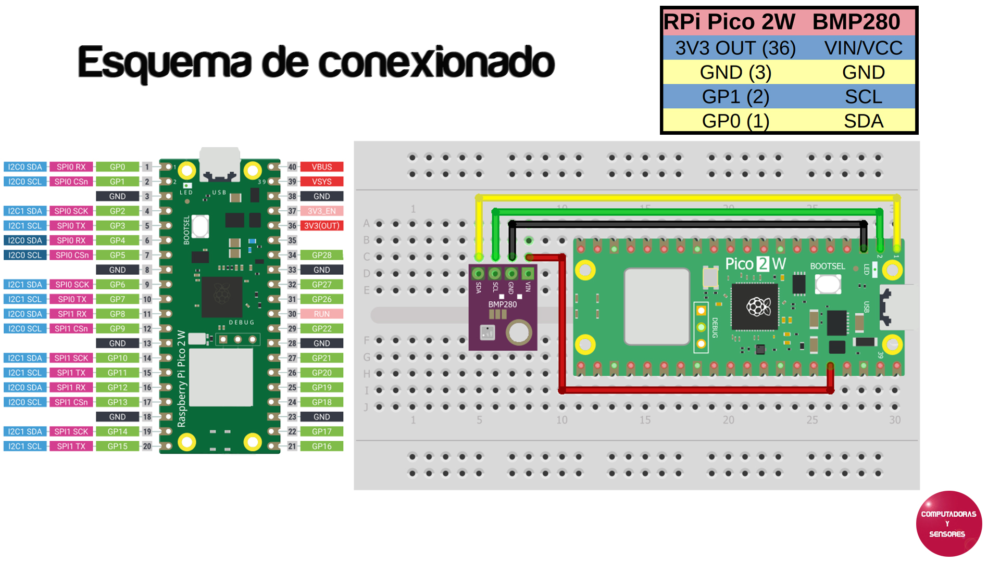

# Código en MicroPython para cliente NATS

El código está escrito para Raspberry Pico W ó Pico 2 W en ambos funciona igual, no se necesita ninguna librería adicional para el manejo del sensor BMP280. No olvidar cambiar las credenciales para tu red WiFi, la contraseña y el IP correspondiente a tu servidor NATS. WireClaw es también un cliente NATS de modo que tiene que usar el mismo IP para NATS que aquí. Para que el código se ejecute con solo alimentar la placa cambiar el nombre a main.py

# Paso a paso

La explicación completa la podrás ver en el siguiente video de YouTube:
https://youtu.be/
